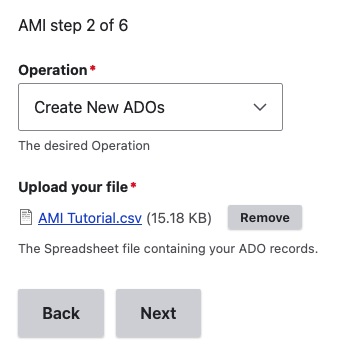
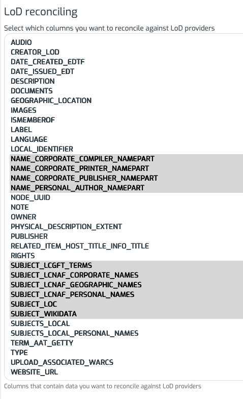

# Archipelago Multi Importer Tutorial Set

For Archipelago's 2.2.0 Release, we developed a new AMI Tutorial Set to help new and existing Archipelago users work through an interactive understanding of Archipelago's Multi Importer (AMI) and other key functionality areas. 

To follow this AMI Tutorial, begin by first downloading and saving copies of these files to your computer:
- AMI Tutorial CSV: [link to doc stored in Archipelago Documentation Repo]
- Advanced AMI Ingest Template: [link to doc stored in Archipelago Documentation Repo]

Then, open your local (or shared Testing/Sandbox Archipelago) instance and begin at Step 1.

!!! note "Tutorial Framing and Recommended Further Learning"

    This tutorial guide covers a step-by-step workflow for using Metadata Display templates (adding new, Previewing), AMI, LoD Reconciliation, and introductory Display Mode concepts.
	
	This succinct tutorial coverage is intended to be a complement to existing Archipelago documentation and your own knowledge. Please proceed through this tutorial, and dive into additional guides as your interest and use case needs dictacte.
	
	Specifically, please see our [Twigs in Archipelago documentation](metadatatwigs.md) overview guide and also our [Working with Twig](workingtwigs.md) primer for more information about Twig templates in Archipelago.
	
	And also see our complete [Archipelago Multi-Importer](ami_index.md) set of guides for additional step-by-step instructions and deeper dives into different AMI uses.

## Step 1: Add the Advanced AMI Ingest Template to your Metadata Displays

1. Navigate to the Metadata Display list at `/admin/content/metadatadisplay/list` (or through the admin menu via  `Manage > Content > Metadata Displays`). From the main Metadata Display List page, you can access all of the different display, rendering, and processing templates found in your Archipelago.

2. Select the 'Add Metadata Display' button.

3. Open the `Advanced AMI Ingest Template` you downloaded earlier. Copy and paste the entire contents of this file into the Twig template code editor box.

4. Scroll down to the bottom of the page and set the "Primary mime type this Twig Template entity will generate as output" to "JSON".

5. Save your newly added Advanced AMI Ingest Template.

## Step 2: Create a New AMI Set for the AMI Tutorial CSV

From either the main Content page `/admin/content` or the AMI Sets List page `/amiset/list`, select the 'Start an AMI set' button to begin. 

#### AMI Set Configuration: Plugin Selection

1. Select the 'Spreadsheet Importer  (if using local CSV file)' for the Plugin type you will be using from the dropdown menu.

2. Select 'Create New ADOs' as the Operation you would like to perform. Under the 'Upload your file' section, select 'Choose File' to upload the AMI Tutorial CSV you downloaded earlier. Be sure to wait for the file to finish uploading before advancing to the next step. After the file is finished uploading, you will have the option to 'Remove' and select a different file if needed.
	
   	

3. For the Data Transformation Selections, use the 'Custom (Expert Mode)' setting for the main setting. Once you select this mode, you will have a larger configuration form open where you will need to set the individual Digital Object Collection or Digital Object type data transformation and mapping options. Setup the following for each of the discreet types found in the AMI Tutorial CSV:

  Type | Data Transformation | Template | Fields and Bundles | File column(s)
  --- | --- | --- | --- | ---
  Collection | Template | Advanced AMI Ingest Template | Strawberry (Descriptive Metadata) for Digital Object Collection | all file columns
  Photograph | Template | Advanced AMI Ingest Template | Strawberry (Descriptive Metadata) for Digital Object | images
  WebPage | Template | Advanced AMI Ingest Template | Strawberry (Descriptive Metadata) for Digital Object | images, upload_associated_warcs
  Article | Template | Advanced AMI Ingest Template | Strawberry (Descriptive Metadata) for Digital Object | documents
  DigitalDocument | Template | Advanced AMI Ingest Template | Strawberry (Descriptive Metadata) for Digital Object | documents
  MultispectralImage | Template | Advanced AMI Ingest Template | Strawberry (Descriptive Metadata) for Digital Object | images
  PodcastEpisode | Template | Advanced AMI Ingest Template | Strawberry (Descriptive Metadata) for Digital Object | audio, images
  

4. For AMI step 4 of 6, select the following:
     - ADO Parent Columns: `ismemberof`
     - Keep the 'Automatically assign UUID' box checked (even though the AMI Tutorial CSV has node_uuid values already)
     - Under the 'Base ADO mappings', select the `label` column for ADO Label

5. For the final AMI configuration step 5 of 6:
      - Specify the name of your AMI Set as "AMI Tutorial", then select the 'Press to Create Set' button.

6. You will now see a message letting you know that 'Your source data was saved and is available as a CSV at ~`linktotheAMIgenerated.csv`. The message will also let you know that your New AMI Set was created and provide a link to the AMI Set page.

## 3. Use AMI's LoD Reconciliation for your AMI Tutorial Set

1. From the main AMI Sets List page, click on your AMI Tutorial Set, or select the 'Edit' option from the Operations menu on the right-hand side of the Sets list. 

2. Navigate to the 'Reconcile LoD' tab for your selected AMI Set.

3. Select the following columns to reconcile against LoD providers. Hold the `shift` key to select multiple columns, and then hold the `command` key to columns and select additional ones.

   	

4. For the LoD Source reconcile options --> LoD Authority Sources, make the following selections:
      - name_corporate_compiler_nampert --> LOC MADS RDF BY TYPE: CORPORATE NAME
	  - name_corporate_printer_nampert --> LOC MADS RDF BY TYPE: CORPORATE NAME
	  - name_corporate_publisher_nampert --> LOC MADS RDF BY TYPE: CORPORATE NAME
	  - name_personal_author_namepart --> LOC MADS RDF BY TYPE: PERSONAL NAME
	  - subject_lcgft_terms --> LOC MADS RDF BY TYPE: GENRE FORM
	  - subject_lcnaf_corporate_names --> LOC MADS RDF BY TYPE: CORPORATE NAME
	  - subject_lcnaf_geographic_names --> LOC MADS RDF BY TYPE: GEOGRAPHIC
	  - subject_lcnaf_personal_names --> LOC MADS RDF BY TYPE: PERSONAL NAME
	  - subject_loc --> LOC SUBJECTS (LCSH)
	  - subject_wikidata --> WIKIDATA Q ITEMS

5. After making the above selections, leave the processing options unchecked, then select the 'Process LoD from Source' button.

6. Given the small size of the AMI Tutorial Set, the LoD Reconciliation process should take less than one minute. When the process is finished, you will see a brief confirmation message. You can choose to review the process selections or to proceed with ingesting your AMI Tutorial Set. See our [AMI LoD Reconciliation Guide Step 4: Edit Reconciled](ami_lod_rec.md#step-4-edit-reconciled-lod) to walk through any further LoD Reconciliation review and editing.

## 4. Use Metadata Display Preview to Review the AMI Tutorial Set

1. Navigate to the Metadata Display list at /admin/content/metadatadisplay/list (or through the admin menu via  Manage > Content > Metadata Displays). Open and select 'Edit' for the 'Advanced AMI Ingest' template.

2. Select 'AMI Set' for the Preview source option. Then enter the row for each object contained in the AMI Tutorial CSV, beginning with row '2'. Keep the `Show Preview with JSON keys used in this template` option selected before pressing `Show Preview`.

3. For each row specified, review each of the Preview Section areas that appear on the right side of the screen:
      - The top section contains full JSON metadata record for the selected digital object or AMI Set + specified row.
      - The middle section will show the 'Reconciliated LoD' for the selected row if any matches are present in the LoD Reconciliation.
      - The bottom section will show the rendered Output from the Template using the metadata from the selected ADO or AMI Set + specified row.
	  - Observe the different ways data elements are present in the AMI Tutorial CSV, the LoD Reconciliation mappings, and how all of the data elements are processed in different sections of the Advanced AMI Ingest Template.
	  - Make note of any data processing that you would like to replicate in your own AMI CSVs and Ingest Templates in your daily work.

4. After you have conducted your Preview for each row in the AMI Tutorial, proceed to the next Tutorial Step (5).

## 5. Process your AMI Tutorial Set.

1. Return to the main AMI Sets List page, click on your AMI Tutorial Set, or select the 'Edit' option from the Operations menu on the right-hand side of the Sets list.

2. Optional: You may wish to double check the settings configured in your AMI Set in the Raw Metadata (JSON) on the AMI Set `View` tab before Processing. See this guide related to [Reviewing an AMI Set's Configuration and Status](ami_set_review.md)

3. Navigate to the `Process` tab. You will have multiple options related to the Processing outcome for your AMI Set. For this AMI Tutorial Set:
      - Keep **Skip ADO processing on missing File** checked.
	  - Keep all of the other enqueing and processing options unchecked.
	  - Set the **Desired ADOS Statuses After Process** to either Unpublished or Published --depending on your personal preference. If you are working in a live/production Archipelago, we would recommended setting these to Unpublished.
	  - Quickly review the note about the _'remaining free space on your Drupal temporary filesystem. Please be aware of that before running a batch with large files'._ While this information is not likely to be relevant for this small AMI Tutorial Set, it's important to keep in mind for real world work with large AMI Sets, especially in production environments with multiple users preparing AMI Sets simultaneously.	

4. Select `Confirm` to continue and Process your AMI Set immediately. Your AMI set will now be Processed. You can follow the set's progress through the `Processing queues` loading screen. After your AMI set is Processed, you will receive confirmation messages letting you know your Digital Objects were successfully created. 

5. To review the newly created Digital Objects and (single) Collection, you can use the **AMI Set Report** tab to quickly navigate through each object. From the AMI Tutorial Set page, navigate to the 'Reports' tab. For each Digital Object or Collection row that was Processed, you will see:
      - a `datetime` stamp
      - one of three `level` (INFO, WARNING, or ERRORS) applicability
      - a `message` summarizing the Processing outcome--including a title/label link to the created ADO if successful
      - a `details` summary containing system information related to the operations.

6. Review the created Collection and 7 different Digital Objects. Read each of the descriptions for each of the Digital Objects, and make note of the following:
      - the object's `type` (JSON value)
	  - the Viewer or Media Player being used
	  - the View Mode being used (and how to review it directly)
	  - the LoD Reconciliation values processed for display and indexing
	  - Anything else that stands out to you about how an object was processed that differs from another object in the CSV	

## That's all folks!

Thank you for completeing this AMI Tutorial. We hope you have found it helpful for your Archipelago understanding. Again, we strongly encourage you to continue your learning about Archipelago through reading additional documentation guides and working through your own use case scenarios.

___

Please contact us on our [Archipelago Commons Google Group](https://groups.google.com/forum/#!forum/archipelago-commons) with any questions or feedback.

Return to the [Archipelago Documentation main page](index.md).
